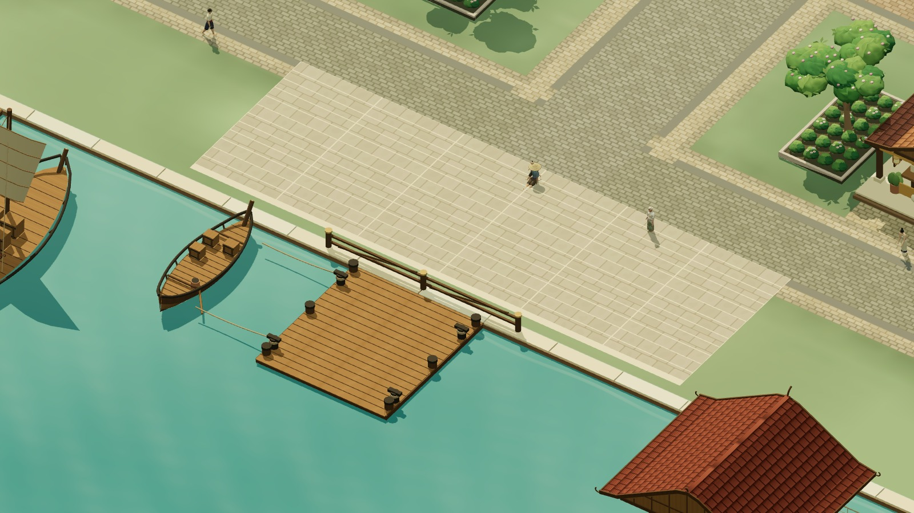
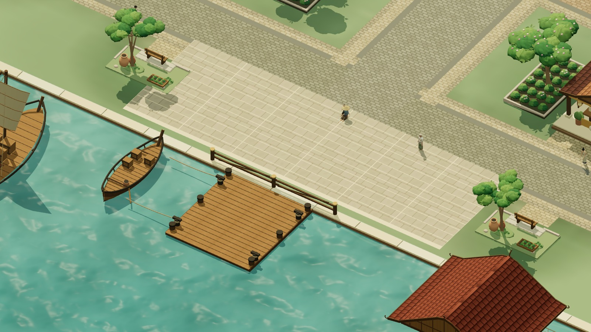
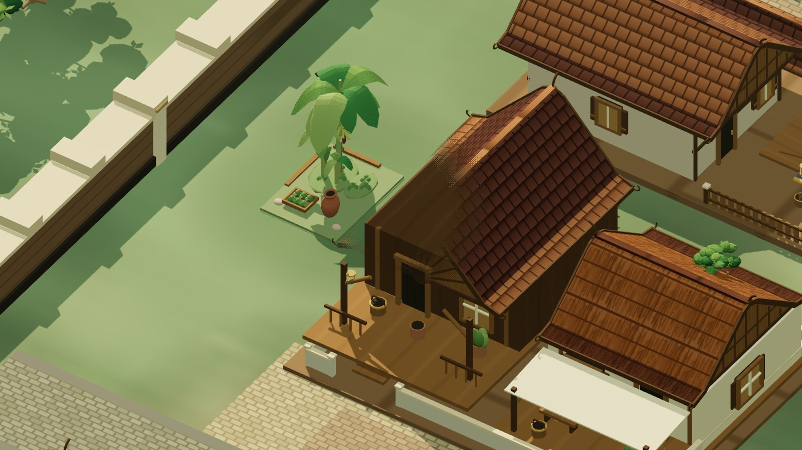
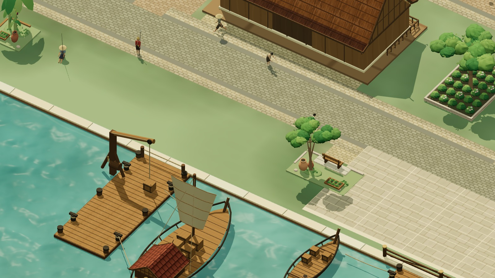

# River surface and Thai street gardens

The deployed compact city had a flat teal river and empty verges. This revision
restores flowing ripple detail inspired by the existing wilderness water and
adds eight small Thai domestic/resting compositions around existing routes.

## Result

- Six asymmetric banana clumps: 18 stalks, broad folded/drooping leaves, young
  growth and six hanging bunches. Leaf motion uses the existing wind/shadow pass.
- Two shaded quay resting pockets, ten ceramic jars and eight vegetable beds.
  Benches face two new paved north approaches with their fronts close to the
  solid boundary. Planting stays behind them, rather than enclosing seats in soil.
- Three moving noise layers, sky-colour reflection and broken sun highlights
  adapt the legacy water technique. Bright daytime contributions were reduced
  after visual review; the evening response remains restrained. The fountain
  and all other maps retain their previous water treatment.

Additional views: [banana landing](banana-landing.jpg),
[harbor overview](harbor-overview.jpg), [evening](harbor-evening.jpg),
[same water camera at simulation t=3](waterfront-motion-3s.jpg),
[actual Game with HUD](production-waterfront.png).

## Changed files

- `src/world/compact-city-neighborhoods.js`: eight shared solid reservations.
- `src/world/compact-city-streets.js`: two flush rest-pocket approaches.
- `src/world/compact-city-render/buildCityStreetGardens.js`: owned/batched
  banana geometry and domestic props; low geometry remains within each plot.
- `src/world/compact-city-render/buildCityLandscape.js`: garden variants,
  shade, softened planting bases and varied edging.
- `src/world/compact-city-render/buildCityWater.js`: compact river lighting and
  ripple changes; borrows sky/sun uniforms without changing shared materials.
- `server/data/collision.json`: fresh source hash, city 47 -> 55 shapes.
- Garden navigation/geometry and river tests; updated garden count assertion.
- `tools/compact-city-production.{html,js}`: review bookmarks, fixed-time water
  comparison and a self-contained review favicon.
- World hooks/layout documentation and these review artifacts.

## Validation

- Full suite: **1,417 passed, 0 failed, 2 existing skips** (1,419 total).
- `npm run build`: passes, 376 modules. Existing large-bundle warning remains.
- Actual guest/Game QA: **24 captures, zero browser errors**. Creation, walking,
  training-dummy combat, save/reload, atlas close, all phase contacts, six class
  masters, four dummies and the boatman-to-waterfront walk pass.
- Client/server collision agrees across **19,257 sampled positions**. All 13
  other map collision objects are unchanged. Obstructed revision-2 city saves
  fall back safely; valid saved positions are preserved.
- Focused tests cover low geometry containment, high canopy clearance, bench
  reach/opening, resource ownership, shader hooks, immutable sky/sun inputs,
  every phase contact and NPC presentation route, paved approaches and saves.
- Production art harness: seven views plus a second water time sample, zero
  browser errors; disposal, idempotent disposal and scene rebuild pass.
- Art Director: approved, **8/10** for style, readability, Thai identity and
  technical visual usability. See [final art review](ART_REVIEW.md).

Machine-readable evidence: [Game QA](game-review.json),
[art/render QA](art-review-data.json), [collision comparison](collision-review.json).
Full test/build logs remain in `artifacts/city-river-gardens/`.

## Limitations

Reflection approximates sky and sun; it does not mirror buildings or NPCs.
The fixed t=0/t=3 images show different simulated water states, not a hardware
FPS measurement. Planting plots remain solid scenery and benches have no new
sitting interaction. Boats and offshore decks retain their existing scenic
status. No paid generation jobs, external asset downloads or gameplay/economy
changes are included. This branch has not been deployed.
