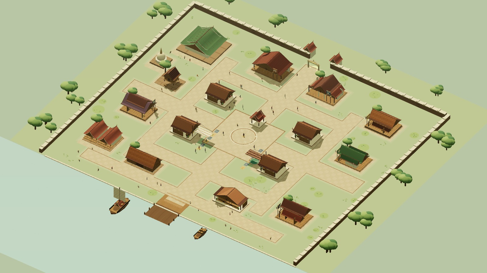

# Compact city production — art and technical review

Status: **APPROVED** for the compact city architecture, reviewed on 2026-10-12.
The Art Director assessed fresh production-renderer and real Game captures.

| Criterion | Final score |
| --- | --- |
| Style match | 8/10 |
| Readability | 8/10 |
| Thai identity | 8/10 |
| Technical usability | 8/10 |

The six schools now have distinct structural silhouettes, Thai roof assemblies,
eaves, supporting timber, galleries and class cues. Shops, temple, stilt houses
and waterfront retain the game's stylized Thai theme. Initial review issues
with missing roof faces, lost texture maps, generic school structures, cleanup
after failed builds and unreadable atlas framing were corrected.

Final polish exposes the night lantern glass between separate metal end caps,
adds restrained world-aligned paving joints, and matches the distant temple's
roof hue to its detailed version. Main inspected fresh day/night captures:
warm lamp bodies are visible, slab joints align, and character/route readability
is retained. The Art Director independently confirmed both refreshed shots and
retained the approval with no required changes. These lamps use emissive surfaces,
not additional shadowed lights.

## Captured evidence

These are screenshots of the actual production scene, not generated concept art.
Wide architectural views use the production camera at zoom 1; overview uses 0.2.
Real Game screenshots retain the default zoom 2 and HUD. The warehouse facade
is explicitly a wider zoom 1.25 view and predates only the lamp/paving polish.

| Architecture | Evidence |
| --- | --- |
| Temple, chedi and kuti | [Temple](temple.jpg) |
| Muay Thai and sword schools | [Northern halls](north-halls.jpg) |
| Raised hunting lodge | [Hunter](hunter.jpg) |
| Herbal veranda | [Herbalist](herbalist.jpg) |
| Ceremonial shaman porch | [Shaman](shaman.jpg) |
| Timber assassin school | [Assassin](assassin.jpg) |
| Plaza, materials and evening lamps | [Day](plaza.jpg), [Night](night-plaza.jpg) |
| Riverfront and warehouse | [Port](port.jpg), [Warehouse facade](warehouse-facade.png) |
| Real production HUD | [Day](production-day.png), [Night](production-night.png) |
| Corrected city atlas | [Atlas](production-atlas.png) |

## Technical review

All 16 canonical destinations have clear routes. The production scene contains
17 building reservations, six school masters, four training dummies and 60
registered city NPCs. All phase contact locations are reachable. Actual client
and server collision agree across 19,257 sampled positions.

Read-only technical review passed five disposal/failure probes, preserving all
shared source geometry/material/texture resources. Source texture maps are
cloned locally. Final browser build/dispose/rebuild also passed; repeated
disposal released nothing twice. Meshes are merged or instanced by spatial
chunk, with distant LODs for the temple and chedi.

The 15 shared server snapshot checks passed for regular/HTTP/stash/trade saves.
See [QA report](../../technical/qa/compact-city-production.md) for full-suite,
build, migration, real-socket and browser results.

## Limits

- Hardware GPU frame time and physical-device FPS have not been measured.
- Headless SwiftShader counters are diagnostic, not a performance claim.
- No new paid Meshy generation was used. This adapts the existing architectural
  kit and retains the approved Meshy NPC models.
- The city is implemented on a task branch; PR creation does not deploy it.
