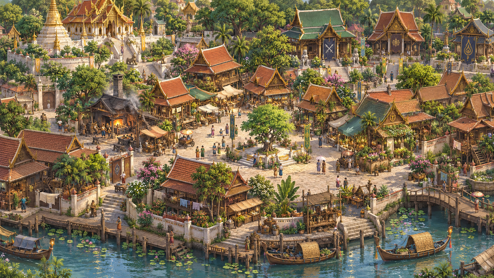

# Forgotten City — atmosphere target

The requested city is **นครที่ถูกลืมเลือน**. The user asked for the charming,
softly painted atmosphere of Ragnarok Origin while retaining this game's Thai
fantasy architecture, readable services and compact navigation.

This is a generated concept, **not an implemented-game screenshot or acceptance
evidence**. Actual captures and review are in [ART_REVIEW.md](ART_REVIEW.md).

## Generation record

- Tool: built-in `image_gen`, new image generation; no existing image edit.
- Final asset: `forgotten-city-target-concept.png`.
- Output intent: near-orthographic 16:9 Thai fantasy town composition, no HUD.
- No Meshy credits were used for this concept or the procedural environment.

## Prompt specification

Create a polished 16:9 near-orthographic Thai fantasy MMORPG town concept with
the soft hand-painted 3D charm of Ragnarok Origin, using original Thai
architecture. Closely group neighborhoods rather than displaying isolated
buildings. Place a temple and chedi in the northwest, class halls behind the
town, a smithy, apothecary and general shop around a small civic square, and a
working riverfront. Use layered roof heights, attached verandas, courtyards,
street-facing canopies and wares, jars, laundry and low walls. Combine lush
canopies with shrubs and groundcover that connect roof groups. Keep clear
walkable lanes and visible service approaches. Use soft daylight, warm plaster,
clay roofs, muted jade and selective gold ornament. Avoid a sparse diorama,
identical standalone buildings, a flat green rectangle, modern objects and
European or Japanese architectural cues. No text, logo or HUD. This is an art
direction target, not a purported screenshot of the implemented game.

Implementation adapts the spatial principles to the existing gameplay scale;
the concept does not promise one-to-one geometry, interiors or asset fidelity.
