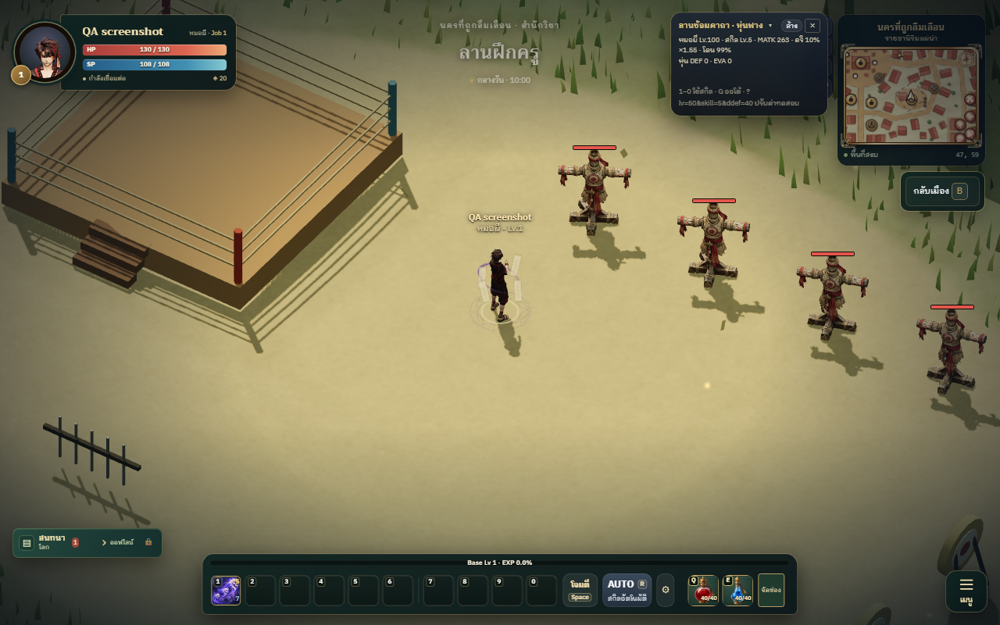
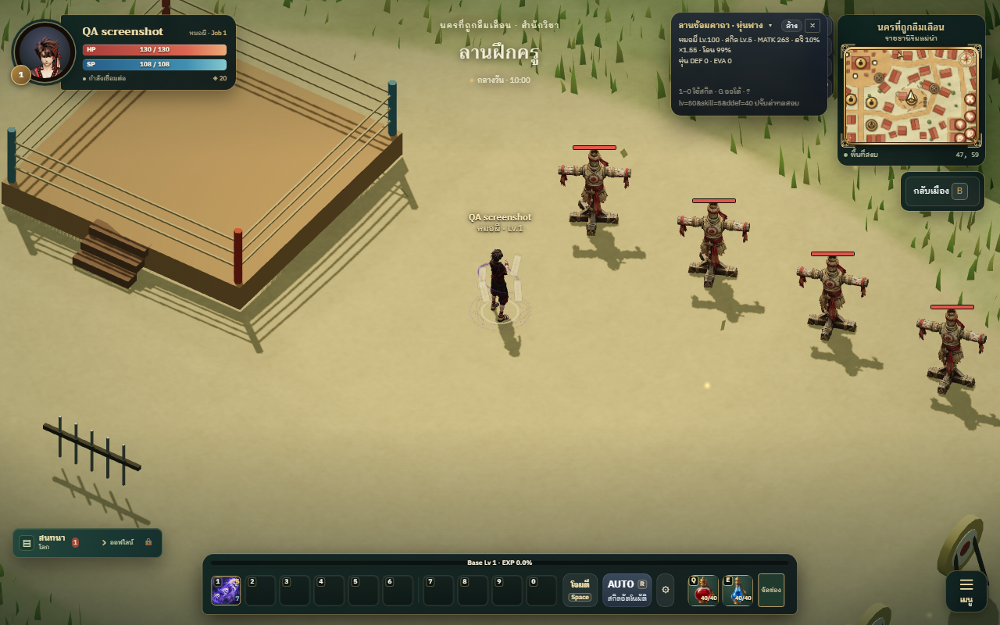

# Live skill screen stability

Repeated casts darkened and brightened the whole viewport. All five class kits call cinematic(), and TrainingGround copied FX mood directly into a full-screen vignette opacity. Baseline shaman casts reached opacity 0.55–1.00. The boxer also had a brief full-screen dim pulse.

The live game now attaches only combat labels. Its legacy dim target remains detached for runner compatibility. Local particles, rings, lights, FX gain, damage, buffs and cast timings remain unchanged. The isolated character-selection preview retains its own cinematic presentation.

## Evidence

These captures include the full DOM at the same mage_kalp stage, not only the WebGL canvas. Vite was restarted before the final candidate run to exclude stale transformed modules.

Baseline vignette: connected, opacity 0.834. Candidate vignette: absent. Both samples retain 12 local FX children. Art approved: style 9/10, readability 9/10, Thai identity 8/10, technical usability 8.5/10.

## Validation

Two behavioral regression tests fail before and pass after the fix. Repository tests: 1013 total, 1011 passed, 0 failed, 2 skipped. Production build passes with the existing bundle-size warning.

Browser QA: 150 successful casts (10 active skills x 5 class kits x 3 render conditions): daytime and nighttime with postprocessing, plus daytime without postprocessing. All have zero connected skill-driven screen overlays. Actual low-quality preference and injected remote mage_kalp checks also pass; the remote adapter retains local FX without changing viewer mood.

Detailed results and supplementary captures: ignored artifacts/skill-flicker-qa/REPORT.md, after-result.json, remote-result.json. Tests/build log: artifacts/skill-flicker-engineer/npm-test.log.

## Limits

Local effect flashes remain intentional. Headless Edge with manual frame simulation does not establish real-device FPS, every hardware path or real socket multiplayer. No deployment or gameplay-rule changes are included.
