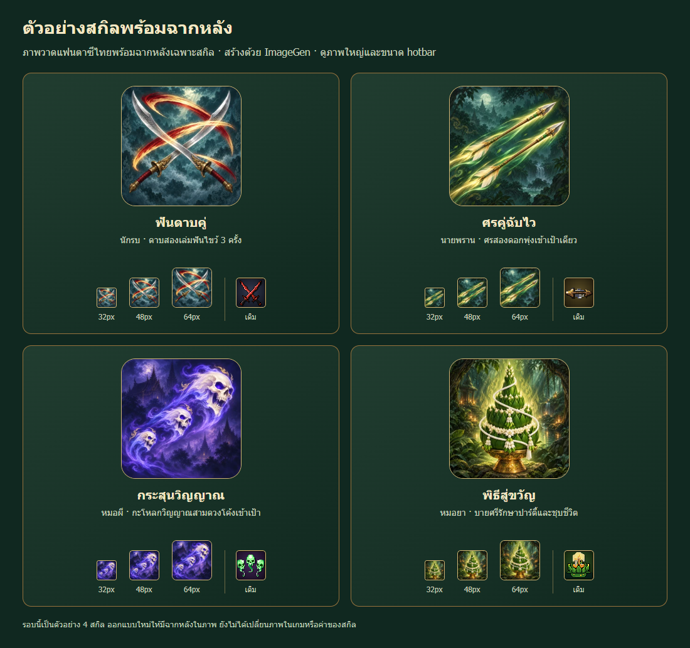

# Thai fantasy skill icon samples — painted backgrounds

Four preview-only skill icons redesigned with the built-in ImageGen tool after the user requested beautiful backgrounds. No runtime skill artwork, combat values, hotbar mapping or deployment changed.

| Skill ID | Name | Painted background |
| --- | --- | --- |
| sword_twin | ฟันดาบคู่ | Cool teal storm clouds, three warm slash arcs |
| arch_quick | ศรคู่ฉับไว | Moonlit emerald forest, two parallel arrows |
| mage_akom | กระสุนวิญญาณ | Indigo Thai temple mist, three skull spirits |
| heal_khwan | พิธีสู่ขวัญ | Sacred jade grove, bai sri and warm healing glow |

## Deliverables

This folder holds untouched PNG masters, exact `.prompt.txt` prompts and `.receipt.json` generation/export provenance for each skill. Production preview WebPs and the gallery are in `public/ui/skills/imagegen-sample-v2/`. Transparent v1 samples are preserved separately in sibling sample-v1 directories for comparison. Every distinct image was a separate built-in ImageGen call; no recoloring or sheet extraction was used.

Preview: http://127.0.0.1:5314/ui/skills/imagegen-sample-v2/preview.html

## Review and validation

Director audited actual move definitions; character artists generated the images; Art Director reviewed all four subjects at 32/48/64 pixels and desktop/mobile gallery captures. Verdict APPROVED for four samples: style 8.5/10, readability 8/10, Thai identity 9/10, technical usability 8.5/10.

QA verified four distinct originals, original/master/output SHA receipts, original PNGs unchanged, actual opaque alpha 255 throughout, and four 256 x 256 WebPs totaling 99,076 bytes. Desktop 1100px and mobile 390px load all twenty image references without overflow, console errors or 404s. Full `npm test`: 1007 total, 1005 pass, zero fail, two skipped. `npm run build` passed; existing chunk-size warning remains. Evidence is under `review/`.

## Limitations

These are four samples awaiting style feedback, not the complete skill library. Scene details, skull faces and ornament merge at 32px but the primary silhouettes remain identifiable. Sword tips are nearer the top rim than the prompted eight-percent margin, without clipping. Actual game hotbar frames, locked states and cooldown overlays require review when these images are integrated. No gameplay or deployed-site verification is claimed.
