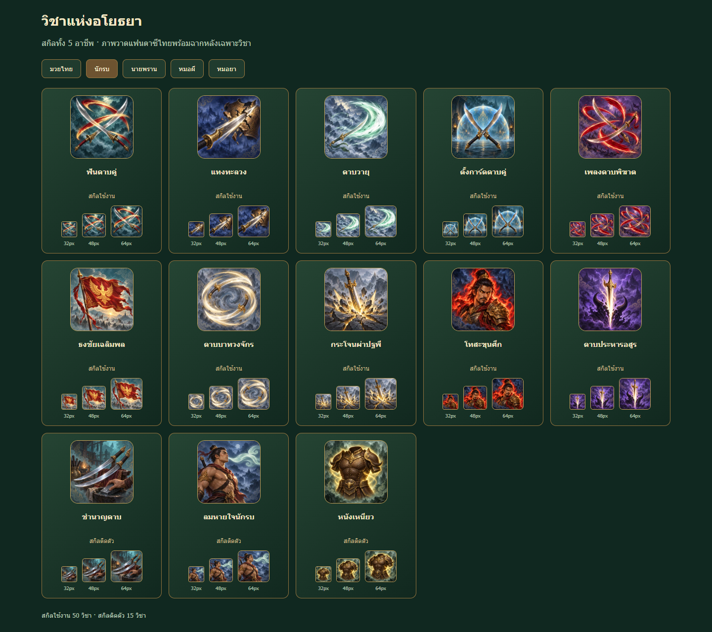
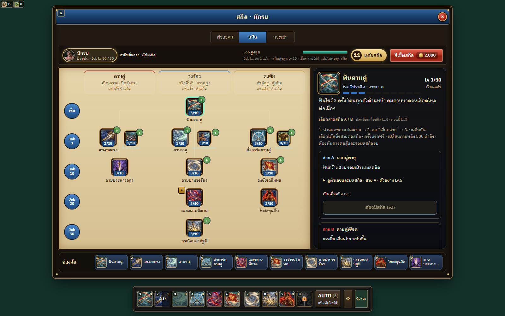

# Painted skill icon production

All 65 learned-skill icons of the five currently playable classes now use the approved ImageGen style: a soft painted Thai fantasy subject and a beautiful supporting painted background. There are 50 active skills and 15 passives, 13 per class. This is icon art, not a change to skill VFX, damage, progression or class availability.

## Deliverables and integration

This folder holds 65 unchanged PNG masters, exact per-skill `.prompt.txt` files and `.receipt.json` generation/export provenance, plus the authoritative inventory and review evidence. Built-in ImageGen created 61 new skill illustrations; four approved v2 samples were reused byte-for-byte. One targeted built-in edit corrected boxer_ngouy to show the caught raised leg and downward elbow. Separate calls generated distinct subjects; no sheet slicing or recolors were used. Git attributes preserve the prompt bytes across Windows checkouts.

Production: `public/ui/skills/painted-complete-v1/` holds 65 opaque 256 x 256 WebPs totaling 1,655,810 bytes and a five-class gallery. PNG masters stay outside the shipped public directory.

Preview: http://127.0.0.1:5314/ui/skills/painted-complete-v1/preview.html

Changed runtime files:

- `src/ui/painted-skill-icons.js`: explicit 65-ID presentation allowlist and local URL resolver; preserves BASE paths, cache suffixes and unknown/data/remote URLs.
- `src/ui/icons.js`: selects full-size smooth painted framing for known skill art, including passive and buff aliases.
- `src/classes/index.js`: selects canonical painted images before legacy helper evaluation, including heal_zone without its old canvas icon.
- `src/character/ui/HotbarEditor.js`: uses the same frame as tree/hotbar/AUTO/creation, replacing the raw image bypass.
- `src/ui/icon-theme.css`: explanatory comment; existing painted-frame styling is reused.
- `tests/icons.test.js` and `tests/painted-skill-icons.test.js`: preserved generic escaping check and four meaningful coverage/routing/framing/provenance regressions.
- `.gitattributes`: exact-byte preservation for skill prompt files.

## Validation

Game Director audited current source semantics and consumers. Artists produced the illustrations. Art Director inspected all 65 images on desktop/mobile galleries and real skill tree, hotbar, chooser and AUTO widgets. Final APPROVED: style 8.5/10, readability 8/10, Thai identity 9/10, technical usability 8.5/10. Corrected boxer_ngouy semantics passed; no remaining blocker.

Independent QA verified 65 distinct originals, unchanged PNG copies, source/export SHA receipts, exact meaningful prompts, actual opaque alpha 255 throughout and 256px WebPs. Ten five-class gallery checks passed without missing images, errors or overflow. Forty desktop/mobile checks of actual application UI classes passed: skill trees, hotbars, chooser assignment, AUTO, buffs and lock/cooldown/MP/active overlays. Final built dist contains all 65 current WebPs byte-for-byte.

Full tests: 1,011 total, 1,009 pass, zero fail, two skipped. Final targeted artwork regression: 4/4 pass. Final production build passed in 552 ms; the existing large main-chunk warning remains. The detailed QA report, structured results and forty corrected screenshots are under `review/`.

## Limitations

This covers the five ready classes. Locked/debug-only assassin skills, legacy rules-only/hybrid skills and boss encounter mechanics are deliberately excluded; A/B evolutions reuse base icons. Fine background scenery, faces and ornament soften at 32px, while primary subjects remain readable. Some action closeups intentionally reach the image edge. Desktop gallery shows 32/48/64px; mobile comparison hides 64px to fit two columns.

Runtime evidence imports the actual application UI classes in an isolated fixture with simulated cooldown/MP/lock states. It is not an end-to-end login, city, combat or multiplayer test, nor physical-device performance testing. The earlier malformed AUTO capture came from fixture CSS order and was replaced with corrected evidence; no application layout change was needed. This branch has not been merged or deployed.
